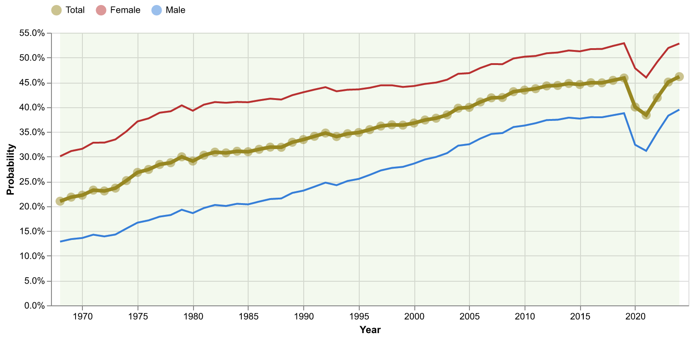
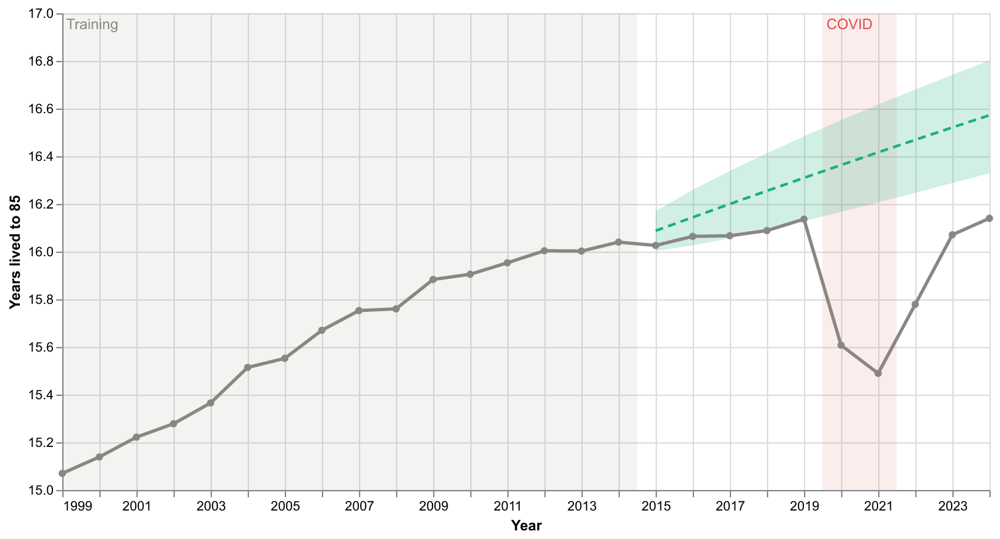
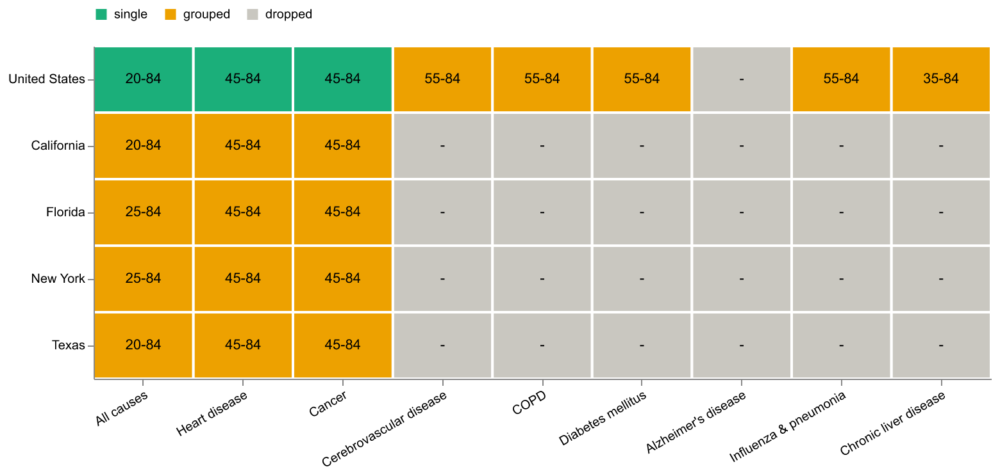
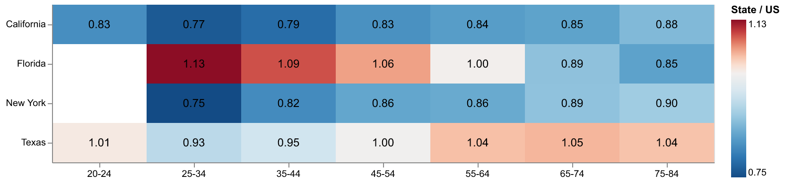

# US Mortality Modeling with CDC WONDER

An actuarial data-science project on US death records from CDC WONDER (1968-2024). It builds
life tables from raw exports, graduates them, decides which state and cause-of-death slices are
statistically credible, fits Lee-Carter and Poisson Lee-Carter mortality models, backtests the
forecast out of sample, and presents the results in a three-page Streamlit dashboard.



## Highlights

- **Long-run trend.** Under each year's death rates, the chance a 20-year-old reaches 85 rose
  from 21.0% in 1968 to 45.9% in 2019, fell to 38.4% in 2021 (COVID), and was back to 46.1% in
  2024.
- **Credibility gate.** Of 135 location × sex × cause combinations, 5 are credible at single-year
  ages, 55 after grouping ages into bands, and 75 are dropped. Each age cell needs at least 1,082
  deaths (the classical full-credibility standard) in every year.
- **State comparison.** On age-standardized all-cause death rates (ages 25-84, 2024), Texas is
  highest (774 per 100,000, 2% above the US) and New York lowest (619, 19% below). New York also
  improved fastest from 1999 to 2024, at 1.51% a year.
- **Out-of-sample backtest.** Trained on 1999-2014, the Poisson Lee-Carter forecast of years
  lived from 65 to 85 was off by 0.76% on average over 2015-2019 and 2.45% through 2024. Deaths
  already ran 2-6% above forecast before COVID (the 2010s slowdown in improvement), then peaked
  at 1.35× forecast in 2021.
- **Model choice, with evidence.** Calibrated on 1999-2024 (both sexes combined), the unweighted
  SVD fit puts 70% of its age weight on ages 25-44 (Poisson: 9%) and tracks the overdose and COVID shocks instead of the
  long-run decline. The Poisson fit weights each cell by its deaths, so it is the primary model.



## The dashboard

| Page | Data | What it shows |
|---|---|---|
| **1. National trends** | National, all causes, 1968-2024, 7 age groups | Chance of reaching 85, expected years lived 20-85, death rates by age, average annual mortality improvement over any chosen window |
| **2. State & cause comparison** | 5 locations × 9 causes × 3 sexes, 1999-2024 | Age-standardized rates by location and by cause, state ÷ US relative mortality by age, improvement by age, computed takeaways, and a coverage matrix of which combinations passed credibility |
| **3. Mortality forecast** | National, all causes, single ages 20-84 | Lee-Carter forecast to 2050 with a 95% band, pre-COVID vs full calibration, the 1999-2014 backtest, model parameters, A/E heatmap and stated limitations |

Every chart responds to its page's controls (years, sex, model, calibration window). The dashboard never
displays raw death or population counts, only derived rates, life-table values and ratios.





## Run it

Tested with Python 3.14 and the exact package versions pinned in `requirements.txt`.

```bash
python -m venv .venv
source .venv/bin/activate          # Windows: .venv\Scripts\activate
pip install -r requirements.txt
```

The data is not in the repository (CDC WONDER terms). Download the exports listed in
[data/README.md](data/README.md), then build every table the dashboard reads.

### Run the pipeline

Run these from the repo root. `python -m` puts the root on the import path, so `src` resolves.

```bash
# National pipeline
python -m scripts.national.clean_wonder_exports     # raw exports -> old_1968_1998.csv, new_1999_2024.csv
python -m scripts.national.harmonize_age_groups     # -> harmonized_1968-2024.csv (page 1)
python -m scripts.national.forecast_precompute      # fits both models, forecasts, backtest -> model/*.csv (page 3)

# State x cause pipeline
python -m scripts.sublevel.combine_exports          # 11 exports -> final.csv
python -m scripts.sublevel.validate_credibility     # -> validation_report.csv and model-ready tables (page 2)

# Dashboard
python -m streamlit run src/dashboard/streamlit_app.py
```

`python -m scripts.national.model_diagnostics` is optional. It is the analyst's view of the same
national models (EDA, Whittaker-Henderson graduation, both Lee-Carter fits, A/E checks), drawn
as matplotlib windows, and writes no files.

## Repository layout

```
├── src/
│   ├── data/            load CDC WONDER exports, clean them, map single ages to age groups
│   ├── actuarial/       life tables, Whittaker-Henderson graduation, Lee-Carter (SVD and Poisson),
│   │                    forecasting, backtest, exploratory plots
│   ├── dashboard/       Streamlit app: one module per page, cached data loaders, chart builders
│   ├── api/             planned FastAPI layer (placeholder)
│   ├── reporting/       planned grounded LLM commentary (placeholder)
│   └── visualization/   planned Power BI / Tableau exports (placeholder)
├── scripts/
│   ├── national/        clean → harmonize → diagnostics → forecast precompute
│   └── sublevel/        combine state × cause exports → credibility validation
├── data/                local only; see data/README.md for how to recreate it
├── config/config.yaml   project decision log: scope, every design decision with its rationale, status
├── archive/             Excel prototype and superseded scripts (see archive/README.md)
├── docs/images/         figures used in this README
├── reports/             reserved for the actuarial memo (not written yet)
├── tests/               reserved for unit tests (not written yet)
├── CLAUDE.md            guidance for AI coding assistants working in this repo
└── requirements.txt
```

## Methods

- **Life tables.** Per year and sex: qx → px → lx (radix 100,000) → dx → Lx → Tx → ex. Grouped
  ages convert central rates with qx = n·m / (1 + 0.5·n·m). Ages stop at 84, so ex is "expected
  years lived up to 85", a temporary life expectancy, and the dashboard labels it that way.
- **Harmonization.** The 1999-2024 single-year ages are bucketed into the 1968-1998 age groups,
  giving one 57-year national series. The 1998/1999 seam coincides with the ICD-9 → ICD-10 switch.
- **Graduation.** Whittaker-Henderson smoothing of ln(qx) with a second-difference penalty and a
  dataset-wide lambda elbow search (`src/actuarial/whittaker_henderson.py`).
- **Credibility.** For each location × sex × cause: single-year ages if every cell has at least
  1,082 deaths in every year; otherwise 7 age groups; failing young groups are truncated; at
  least 3 groups must remain; and a single-factor Lee-Carter fit must explain at least the
  national benchmark's share of variance minus 0.05. Years are never pooled.
- **Age standardization.** Direct method with US 2000 population weights, over the age groups
  every compared series kept, so older populations (Florida) compare fairly.
- **Lee-Carter.** ln m(x,t) = ax + bx·kt, fitted by SVD and by Poisson maximum likelihood
  (Brouhns, Denuit and Vermunt, 2002) with Newton-Raphson updates. kt is forecast as a random
  walk with drift; the 95% band covers kt process error only, so it understates total uncertainty.
- **Backtest.** Fit on 1999-2014, forecast 2015-2024, compare years lived and actual/expected
  deaths. COVID years are shown as an expected divergence, not tuned away.

Every choice above, with the alternatives considered and why they were rejected, is recorded in
[config/config.yaml](config/config.yaml).

## Status

| Done | Planned |
|---|---|
| Raw → processed pipeline, age harmonization | FastAPI layer serving filtered data (`src/api/`) |
| Life tables, graduation, SVD and Poisson Lee-Carter, forecasting | Grounded LLM commentary with an "actuarial review required" label (`src/reporting/`) |
| Credibility validation with a full audit trail | Unit tests for life-table invariants (`tests/`) |
| Out-of-sample backtest | Comparison with Human Mortality Database Lee-Carter benchmarks |
| Three-page Streamlit dashboard | One-page actuarial memo, Power BI version |

## Limitations

- Period measures: each year's rates applied at every age, not the experience of a real cohort.
- Ages 20-84 only, and state-level results only for causes and ages that pass credibility.
- One Lee-Carter factor with a fixed age pattern of improvement, and no cohort effect.
- COVID-19 (2020-2022) is a shock, not a trend. Results depend on whether a calibration window
  includes it, so the dashboard shows both choices.

## Data source

Centers for Disease Control and Prevention, National Center for Health Statistics. Compressed
Mortality File 1968-1998 and Underlying Cause of Death 1999-2024, CDC WONDER Online Database.
